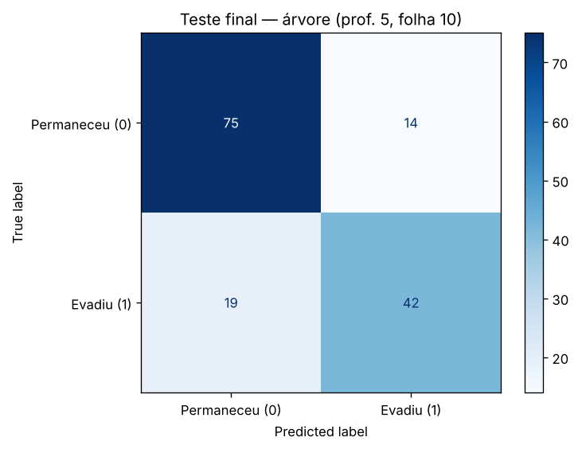
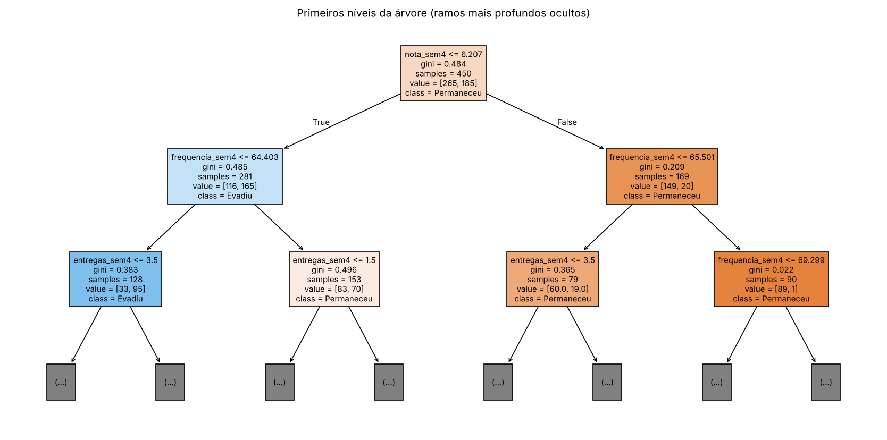
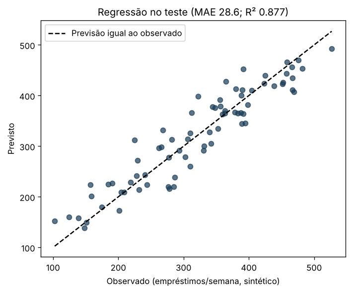
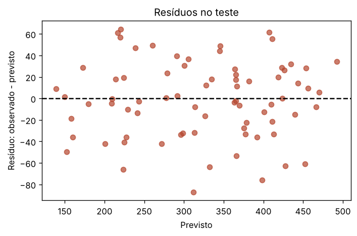

**Profa. Kadidja Valéria | UDF**  
Ciência de Dados e Aprendizado de Máquina · Sistemas de Informação · 2026.2

# Aula 2 — Registro do laboratório supervisionado

## Identificação

- Estudante ou equipe: **Ramon Guilherme Marques do Nascimento**
- Turma: **Turma de Ciência de Dados – UDF — Sistemas de Informação**
- Data de realização: **16/10/2026**
- Integrantes e contribuições (se em equipe): **Atividade individual: executei o notebook, fiz os experimentos e escrevi este relatório.**

## Percurso escolhido

- [x] Python/Colab ou Jupyter.
- [ ] Orange Data Mining.

Use o [notebook de apoio](notebooks/laboratorio.ipynb) ou o [CSV sintético](dados/educacionais-sinteticos.csv). O CSV contém 600 registros fictícios. Atributos: `frequencia_sem4`, `nota_sem4`, `entregas_sem4`. Alvo: `evasao_fim_semestre` (0 permaneceu, 1 evadiu). As associações foram definidas pela simulação, sem validade empírica sobre estudantes reais.

## 1. Ambiente e reprodução

| Item | Registro |
| --- | --- |
| Ambiente e data | Jupyter (kernel Python 3) em Linux, execução completa com `jupyter nbconvert --execute`, 16/10/2026. O notebook também abre no Colab pelo botão do [README](README.md). |
| Versões das ferramentas/bibliotecas | Python 3.13.18; NumPy 2.5.3; pandas 3.0.5; matplotlib 3.11.2; scikit-learn 1.9.1 (impressas na primeira célula do notebook) |
| Semente aleatória | 42 (`SEMENTE = 42`), usada na simulação, em `train_test_split`, em `StratifiedKFold`/`KFold` e na árvore |
| Caminho do notebook executado ou fluxo Orange | [notebooks/laboratorio-ramon.ipynb](notebooks/laboratorio-ramon.ipynb); números gravados em [notebooks/resultados_execucao.json](notebooks/resultados_execucao.json) |
| Origem dos dados e condição sintética | Gerados pela simulação do notebook. Acrescentei uma célula que compara a simulação com o CSV da disciplina: resultado `True`, ou seja, são os mesmos 600 registros. Totalmente sintéticos. |

## 2. Problema e preparação

- Pergunta de negócio: **Com o que se sabe ao fim da semana 4, quais estudantes deveriam ser os primeiros a receber um convite voluntário da equipe de apoio?**
- Unidade de análise e horizonte: **Um estudante fictício em um semestre. A previsão é feita no fim da semana 4; o desfecho só é conhecido no fim do semestre.**
- Atributos disponíveis no instante da previsão: **`frequencia_sem4` (% de presença, 35 a 100), `nota_sem4` (0 a 10) e `entregas_sem4` (atividades entregues, 0 a 8).**
- Variável-alvo e sua natureza: **`evasao_fim_semestre`, categórica binária. 59,0% permaneceram (0) e 41,0% evadiram (1).**
- Ausências e outros problemas encontrados: **30 ausências (5%), todas em `nota_sem4`. Não há identificadores nem duplicatas. O alvo foi sorteado a partir de uma probabilidade, então existe ruído: dois estudantes com atributos iguais podem ter desfechos diferentes. Na exploração do treino, a evasão cai de 74,0% (nota até 2,5) para 11,1% (nota acima de 7,5).**
- Tratamentos e conjunto usado para aprendê-los: **Imputação pela mediana (`SimpleImputer`) como primeiro passo de um `Pipeline`. A mediana é aprendida só com o treino e, durante a validação cruzada, só com a parte de treino de cada dobra. A árvore não precisa de padronização.**

## 3. Desenvolvimento e teste

- Método de divisão e justificativa: **Holdout estratificado (`train_test_split`, `test_size=0.25`, `stratify=y`, `random_state=42`). Na simulação, cada estudante é independente dos demais, então a divisão aleatória é aceitável; a estratificação deixa a proporção de evasão igual nos dois lados (0,411 no treino e 0,407 no teste). Com dados reais, eu separaria por semestre (treinar no passado e testar no semestre seguinte).**
- Quantidades de treino e teste: **450 registros para treino e 150 para teste.**
- Procedimento de validação no treino: **Validação cruzada estratificada em 5 partes (`StratifiedKFold`, `shuffle=True`, `random_state=42`) sobre os 450 registros de treino.**
- Parâmetros da árvore e como foram escolhidos: **Comparei `max_depth` ∈ {2, 3, 5, None} com `min_samples_leaf=10` (roteiro) e, antes de abrir o teste, também `min_samples_leaf` ∈ {5, 20, 40}. A profundidade 5 teve a maior média de validação (0,7222). A folha 40 chegou a 0,7289, mas a diferença (0,0067) ficou bem dentro do desvio entre dobras (0,03 a 0,05). Mantive `max_depth=5`, `min_samples_leaf=10`.**
- Como o teste ficou fora da seleção: **Toda a escolha foi feita com validação cruzada no treino, inclusive a grade de folhas, que coloquei antes da célula de teste. O pipeline final foi ajustado nos 450 registros e aplicado ao teste uma única vez. Os experimentos posteriores (pesos, limiar, retirada de atributos) também usam só validação cruzada no treino.**

### Alternativa Orange

Confira o alvo como categórico. Registre as conexões: File/Select Columns → Test & Score (Data), Tree → Test & Score (Learner), Test & Score → Confusion Matrix (Evaluation Results). Data Table permite inspeção. Se usar Preprocess, conecte o preprocessor ao learner para ajustar transformações dentro do treino. Não use apenas `Test on train data` como avaliação final.

**Fluxo e método de avaliação realmente utilizados:** Não se aplica. Usei o percurso em Python/Jupyter (holdout estratificado 75/25 e validação cruzada estratificada em 5 partes no treino).

Se comparar configurações, use validação no treino e reserve teste independente. Documente em Test & Score as entradas Data e Test Data, quando utilizadas.

## 4. Resultados calculados de classificação

| Modelo | Configuração | Acurácia de treino | Acurácia de validação e dispersão | Acurácia de teste |
| --- | --- | --- | --- | --- |
| Referência | `DummyClassifier(strategy='most_frequent')`, sempre prevê 0 | 0,5889 | 0,5889 ± 0,0000 | 0,5933 |
| Árvore final | Mediana + `DecisionTreeClassifier(max_depth=5, min_samples_leaf=10, random_state=42)` | 0,8133 (ajuste nos 450); 0,8111 (média nas dobras) | 0,7222 ± 0,0391 | **0,7800** |

**Matriz: linhas reais e colunas previstas; classe positiva = 1.** ([imagem](assets/matriz-confusao.png))

| Real / previsto | Permaneceu (0) | Evadiu (1) |
| --- | --- | --- |
| Permaneceu (0) | 75 (TN) | 14 (FP) |
| Evadiu (1) | 19 (FN) | 42 (TP) |

- Acurácia calculada manualmente pela matriz: **(TN + TP) / total = (75 + 42) / (75 + 14 + 19 + 42) = 117 / 150 = 0,78.**
- Sensibilidade da classe 1: **TP / (TP + FN) = 42 / (42 + 19) = 42 / 61 ≈ 0,689. Calculei também a precisão da classe 1: TP / (TP + FP) = 42 / 56 = 0,750, e o F1 da classe 1 = 0,718.**
- Comparação com referência: **A árvore ganha 18,7 pontos percentuais de acurácia (0,780 contra 0,593). A diferença mais importante, porém, está na classe 1: a referência não encontra nenhuma evasão (sensibilidade 0), e a árvore encontra 42 das 61.**
- Consequências dos falsos positivos: **14 estudantes que iriam permanecer receberiam o convite. O custo é tempo da equipe e, se a abordagem for mal feita, a sensação de estar sendo "marcado". Como o convite é voluntário e não muda nada na vida acadêmica da pessoa, considero esse erro tolerável.**
- Consequências dos falsos negativos: **19 estudantes que evadiram (31% dos casos de evasão) não seriam sinalizados. Esse é o erro que mais me preocupa, porque é justamente quem mais precisaria do convite. Por isso, o modelo só pode priorizar o contato; o apoio precisa continuar aberto a quem procurar por conta própria.**
- Interpretação do gráfico e da árvore: **A raiz pergunta `nota_sem4 ≤ 6,21` e divide os 450 estudantes de treino em 281 (165 evasões) e 169 (só 20 evasões). Nos dois lados, a segunda pergunta é sobre frequência (≤ 64,40 e ≤ 65,50), e entregas aparece no terceiro nível. No ramo nota > 6,21 e frequência > 65,50, há 90 estudantes de treino e só 1 evasão; desses, os 79 com frequência acima de 69,30 permaneceram todos. Importâncias: nota 0,622, frequência 0,235 e entregas 0,143. Leio isso como a forma que a árvore achou para separar estes dados simulados, e não como explicação do porquê alguém evade ([árvore](assets/arvore.png)).**

## 5. Experimentos no treino

Compare parâmetros usando apenas treino/validação. Após conhecer o teste, uma nova seleção exige novo teste independente para avaliação final.

| Experimento | Alteração | Resultado de validação | Interpretação |
| --- | --- | --- | --- |
| 1 | `min_samples_leaf` = 5, 20 e 40, cruzado com `max_depth` 2, 3, 5 e None (feito **antes** do teste) | Melhor de cada folha: folha 5 → 0,7222 ± 0,0298 (prof. 5); folha 10 → 0,7222 ± 0,0391 (prof. 5); folha 20 → 0,7267 ± 0,0480 (prof. 5 ou None); folha 40 → 0,7289 ± 0,0303 (prof. 5 ou None). Distância treino–validação: de 0,154 (folha 5, prof. None) a 0,047 (folha 40). | Folhas maiores reduzem bastante o sobreajuste, mas mudam pouco a validação: todas as diferenças são menores que o desvio. Mantive folha 10. A folha 40 fica registrada como alternativa mais estável, a testar com um novo conjunto de teste. |
| 2 | Retirar um atributo de cada vez (prof. 5, folha 10) | Completo: 0,7222. Sem frequência: 0,7156 ± 0,0362; sem nota: 0,6289 ± 0,0475; sem entregas: 0,7022 ± 0,0310. | Só a retirada da nota causa uma queda (−0,093) maior que o desvio. A nota é o atributo mais útil para prever **nesta simulação**. |
| 3 (extra) | `class_weight='balanced'` e limiar de decisão 0,3/0,4/0,5, com `cross_val_predict` no treino | Padrão (limiar 0,5): sensibilidade 0,676, precisão 0,658, 190 sinalizados. Limiar 0,3: sensibilidade 0,800, precisão 0,590, 251 sinalizados. Balanceado com limiar 0,5: sensibilidade 0,708, precisão 0,652. | Baixar o limiar encontra mais evasões ao custo de muito mais convites. A escolha depende de quantos contatos a equipe consegue fazer. Não apliquei ao teste, porque seria uma nova seleção. |

Responda:

1. Como a profundidade e o tamanho das folhas podem afetar o sobreajuste? **Uma árvore funda, com folhas pequenas, consegue criar uma regra para quase cada estudante do treino, inclusive para os casos que são puro ruído. No meu experimento, folha 5 e profundidade livre chegaram a 0,868 no treino e só 0,713 na validação. Folhas de pelo menos 40 registros impedem essas regras de exceção, e a distância caiu para 0,047. No outro extremo, a profundidade 2 é simples demais e erra até no treino (0,733), o que é subajuste. O ponto certo fica entre os dois, e quem indica é a validação, não o treino.**
2. Retirar um atributo e observar mudança no desempenho prova causalidade? **Não. A queda só diz que, sem aquele atributo, o modelo perde informação para prever, considerando os outros atributos e este conjunto de dados. Um atributo pode ser apenas um "sintoma" de uma causa que não foi medida (emprego novo, problema de saúde), e dois atributos correlacionados podem substituir um ao outro, escondendo a importância de ambos. Para falar em causa, eu precisaria de um desenho experimental ou de métodos causais, e não de uma comparação de acurácia.**
3. Se 95% permanecem, o que acontece com um modelo que sempre prevê permanência? **Executei a situação no notebook: em uma turma hipotética de 200 estudantes com 10 evasões, sempre prever permanência dá acurácia 0,95. A matriz mostra o problema: TN = 190, FP = 0, FN = 10, TP = 0, e a sensibilidade é zero. Pela acurácia, o modelo parece ótimo; para o objetivo, que é achar quem precisa de apoio, ele não serve para nada.**

## 6. Regressão — seção independente

Execute a seção da biblioteca no notebook ou registre o procedimento equivalente em Orange. Dados também sintéticos. Alvo numérico: empréstimos por semana.

| Item | Registro |
| --- | --- |
| Atributos e alvo | `usuarios_ativos` (100 a 1.000) e `horas_abertura` (20 a 60 h por semana); alvo `emprestimos_semana`. 300 semanas sintéticas. |
| Divisão e preparação | Holdout aleatório 75/25 (225 treino, 75 teste), `random_state=42`; pipeline com imputação pela mediana (não havia ausências) e `LinearRegression`. Coeficientes aprendidos: 0,348 por usuário ativo e 2,297 por hora de abertura; intercepto 37,32. |
| MAE do modelo e unidade | **28,59 empréstimos por semana** |
| MAE da referência | **84,73 empréstimos por semana** (`DummyRegressor` com a média do treino; R² da referência no teste: −0,0037) |
| R² do teste | **0,8774** |
| Interpretação do gráfico observado/previsto | Os pontos seguem a diagonal em toda a faixa observada no teste (cerca de 100 a 530 empréstimos), sem curvatura e sem um trecho em que o modelo erre sempre para o mesmo lado. A relação linear descreve bem estes dados, o que é esperado, porque a simulação foi linear ([imagem](assets/regressao-observado-previsto.png)). |
| Interpretação dos resíduos | Média −1,28 (sem viés), desvio 35,47 (próximo do σ = 35 da simulação), mínimo −87,24, máximo 64,59. A correlação entre resíduo e previsão é 0,027, sem padrão de funil ou curva. Em 12 das 75 semanas de teste o erro passa de 50 empréstimos. Nos cinco primeiros registros, os erros absolutos foram 0,50; 0,39; 36,23; 42,29 e 3,85 ([imagem](assets/regressao-residuos.png)). |
| Limitação de extrapolação | O treino só cobre 100 a 1.000 usuários e 20 a 60 horas. Pedi ao modelo uma previsão para 10.000 usuários e 100 horas, e ele respondeu 3.746,9 empréstimos sem nenhum aviso. Esse número não tem base: acervo, equipe e espaço têm limite, e a relação pode deixar de ser linear. Além disso, a divisão aleatória ignora a ordem das semanas e a sazonalidade, o que não seria aceitável com dados reais. |

**Retirada de atributo (validação cruzada em 5 partes no treino):** com os dois atributos, MAE 28,89 e R² 0,867; só usuários ativos, MAE 35,90 e R² 0,798; só horas de abertura, MAE 83,73 e R² 0,048. Os usuários ativos carregam a maior parte da informação, e as horas acrescentam uma melhora menor, mas consistente.

Explique por que R² não é porcentagem de acertos: **R² = 1 − (soma dos erros quadráticos do modelo) / (soma dos erros quadráticos de prever a média do conjunto avaliado). É uma comparação com uma referência, e não uma contagem de acertos. Em regressão, quase nunca a previsão é exatamente igual ao valor real, então "acerto" nem faz sentido. Meu R² de 0,877 significa que o erro quadrático do modelo é cerca de 88% menor que o de chutar sempre a média, e não que 88% das semanas foram previstas corretamente. Se o modelo fosse pior que a média, o R² seria negativo.**

## 7. Evidências e conclusão

- Link relativo do notebook/fluxo: **[notebooks/laboratorio-ramon.ipynb](notebooks/laboratorio-ramon.ipynb)** (resultados em [notebooks/resultados_execucao.json](notebooks/resultados_execucao.json))
- Links das imagens, se houver: **[assets/matriz-confusao.png](assets/matriz-confusao.png), [assets/arvore.png](assets/arvore.png), [assets/regressao-observado-previsto.png](assets/regressao-observado-previsto.png), [assets/regressao-residuos.png](assets/regressao-residuos.png)**
- Principal aprendizado: **A ordem das etapas importa tanto quanto o algoritmo: separar o teste primeiro, colocar a imputação dentro do pipeline, fazer toda comparação (até a grade de folhas e o limiar) na validação do treino e só então abrir o teste. E nunca olhar só a acurácia: a matriz mostrou que 31% das evasões passariam despercebidas.**
- Limitações de generalização e vieses possíveis: **Os dados são sintéticos e as relações foram escolhidas pela fórmula da simulação. Existe uma única divisão de teste com 150 registros (cada estudante vale 0,67 ponto percentual), então 0,78 tem margem de incerteza. Não há grupos reais (turno, curso, renda) para checar se o modelo erra mais com alguém. Em dados reais, a divisão teria de ser temporal.**
- Cuidados com privacidade e uso responsável: **Usar só os três atributos necessários, sem identificador no modelo; restringir o acesso à lista à equipe de apoio; nunca usar a sinalização para avaliar ou punir; manter revisão humana antes de qualquer contato e o convite sempre opcional. A proposta completa está na [atividade 04](04-pbl-permanencia.md).**

[Voltar ao início](README.md).
