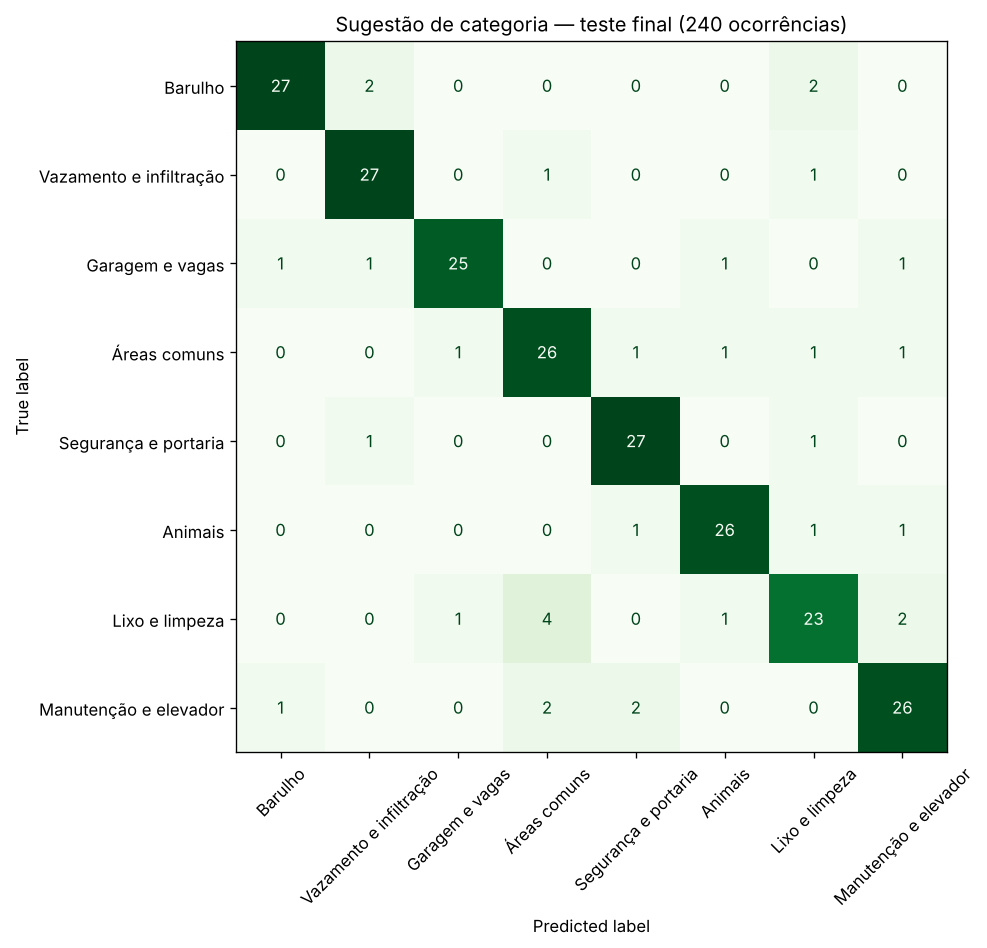

**Profa. Kadidja Valéria | UDF**  
Ciência de Dados e Aprendizado de Máquina · Sistemas de Informação · 2026.2

# Aplicação ao projeto — livro de ocorrências digital

## Identificação

- Estudante ou equipe: **Ramon Guilherme Marques do Nascimento**
- Turma: **Turma de Ciência de Dados – UDF — Sistemas de Informação**
- Data de realização: **16/10/2026**
- Integrantes e contribuições: **O experimento desta atividade (formulação, dados sintéticos, notebook e análise) foi feito individualmente por mim. O projeto em que ele se apoia é desenvolvido em dupla com Arthur Rodrigues de Souza Vieira, responsável pelo sistema e pelo painel; minha parte no projeto é a coleta, o tratamento e a análise dos dados.**

## 1. O projeto

O projeto da Unidade III ([documento de definição](../Unidade_3_Gestao_de_Projetos_em_Ciencia_de_Dados/Definicao-Projeto-Ciencia-de-Dados.md)) trata de um problema comum em prédios antigos do DF: as ocorrências do condomínio (barulho, vazamentos, garagem, áreas comuns) ainda são anotadas em um **livro de papel na portaria**. Esse livro não permite acompanhar o andamento, consultar o histórico nem medir nada, e ainda expõe ocorrências de terceiros a quem passa pela portaria. O plano é:

- **transcrever e anonimizar** de 12 a 24 meses do livro de um condomínio real e categorizar cada registro em dupla, com meta de concordância ≥ 80% (minha responsabilidade);
- fazer a **análise exploratória** (Pareto por categoria, mapa de calor dia × horário, taxa e tempo de resposta, recorrência);
- desenvolver um **livro de ocorrências digital** com painel de indicadores para o síndico (responsabilidade do Arthur) e avaliá-lo em um piloto.

O documento de definição deixa **inteligência artificial e aprendizado de máquina fora do escopo**; a classificação automática aparece como trabalho futuro. Esta atividade é justamente um estudo preliminar desse trabalho futuro, feito só com dados sintéticos, para entender se vale a pena e o que ele exigiria dos dados do projeto.

## 2. Problema escolhido

No registro digital, quem cria a ocorrência (morador ou porteiro) escreve uma descrição livre e escolhe uma categoria. Escolher a categoria tem dois problemas: dá trabalho, e pessoas diferentes escolhem categorias diferentes para o mesmo caso. Isso desorganiza o Pareto e o painel do síndico.

- **Pergunta de negócio:** é possível **sugerir automaticamente a categoria** de uma ocorrência a partir do texto digitado, para agilizar o registro e padronizar as categorias?
- **Decisão apoiada:** pré-selecionar a categoria no formulário de registro, apenas quando o modelo estiver confiante. A pessoa sempre confirma ou troca, e o síndico pode recategorizar.
- **Unidade de análise:** uma ocorrência registrada.
- **Atributo:** `texto`, a descrição livre, conhecida no momento do registro.
- **Alvo:** `categoria`, uma de 8: Barulho; Vazamento e infiltração; Garagem e vagas; Áreas comuns; Segurança e portaria; Animais; Lixo e limpeza; Manutenção e elevador. As quatro primeiras vêm dos exemplos do documento de definição; as outras são tipos frequentes em livros de portaria.
- **Tipo de tarefa:** classificação supervisionada multiclasse. No projeto real, os rótulos viriam da categorização feita em dupla durante a transcrição.

## 3. Dados

| Item | Registro |
| --- | --- |
| Origem | **Sintética**, gerada pelo próprio notebook a partir de modelos de frase por categoria, com lacunas sorteadas ("Infiltração no {local} vindo do apto de cima"). **Nenhum registro do livro real foi usado.** Unidades aparecem só como "apto XXX" e "bloco X"; não há nomes, placas ou telefones. |
| Tamanho | 960 ocorrências, de 116 a 124 por categoria; 506 registradas por morador e 454 pela portaria ([CSV](dados/ocorrencias_textos_sinteticos.csv)) |
| Ruído simulado | 25% sem acento e 10% em minúsculas; 20% com cabeçalho ("Registro da portaria:") e 20% com complementos neutros ("Morador pede retorno"); 5% de descrições genéricas ("Favor verificar"); **10% de categorias trocadas ao acaso**, imitando divergência de categorização. Resultado: 815 registros limpos, 92 com categoria trocada, 49 genéricos e 4 genéricos com categoria trocada. |
| Ambiguidade proposital | "barulho" também aparece em *Manutenção* ("elevador fazendo barulho"), "garagem" em *Segurança* e *Vazamento*, locais como hall e pilotis em quase todas as categorias. |
| Por que não usar dados reais | A transcrição do livro ainda depende da autorização do síndico e, possivelmente, de parecer do Comitê de Ética. Além disso, as descrições reais contêm dados pessoais (LGPD), e o modelo só poderia ser treinado depois da anonimização. |

## 4. Método

| Item | Registro |
| --- | --- |
| Ambiente | Jupyter, Python 3.13.18, scikit-learn 1.9.1, pandas 3.0.5, NumPy 2.5.3, matplotlib 3.11.2. Semente 42. |
| Notebook | [notebooks/ocorrencias-sugestao-categoria.ipynb](notebooks/ocorrencias-sugestao-categoria.ipynb) (executado, autocontido, abre no Colab). Resultados em [notebooks/resultados_ocorrencias.json](notebooks/resultados_ocorrencias.json). |
| Divisão | Holdout estratificado 75/25: 720 para treino e 240 para teste |
| Preparação | TF-IDF **dentro do Pipeline**, aprendido só no treino de cada dobra, com remoção de acentos e minúsculas. Duas representações candidatas: **palavras** (unigramas e bigramas) e **caracteres** (`char_wb`, 2 a 5), que tolera erros de digitação. |
| Modelos candidatos | Regressão logística (C = 1 e 10), Naive Bayes multinomial (alpha = 0,1 e 0,5) e SVM linear (C = 0,3 e 1) |
| Seleção | Validação cruzada estratificada em 5 partes, **só no treino**, pelo maior F1 macro médio. O teste foi usado uma única vez. |
| Referência | `DummyClassifier`, que sempre prevê a categoria mais frequente |
| Limiar de confiança | Escolhido com probabilidades fora da dobra (`cross_val_predict`) no treino; o teste só confirma. |

## 5. Resultados calculados

**Validação cruzada (treino, 720 ocorrências):**

| Candidato | Acurácia de treino | Acurácia de validação ± desvio | F1 macro de validação |
| --- | --- | --- | --- |
| **Caracteres + LogReg, C = 1 (escolhido)** | 0,8694 | **0,8458 ± 0,0172** | **0,8457** |
| Caracteres + LinearSVC, C = 0,3 | 0,8715 | 0,8458 ± 0,0119 | 0,8452 |
| Palavras + MultinomialNB, alpha = 0,5 | 0,8722 | 0,8444 ± 0,0143 | 0,8447 |
| Palavras + LogReg, C = 1 | 0,8722 | 0,8444 ± 0,0121 | 0,8447 |
| Palavras + MultinomialNB, alpha = 0,1 | 0,8736 | 0,8403 ± 0,0139 | 0,8408 |
| Caracteres + LinearSVC, C = 1 | 0,8806 | 0,8389 ± 0,0092 | 0,8385 |
| Palavras + LogReg, C = 10 | 0,9208 | 0,8264 ± 0,0076 | 0,8267 |
| Caracteres + LogReg, C = 10 | 0,8962 | 0,8264 ± 0,0088 | 0,8261 |
| Referência (mais frequente) | 0,1295 | 0,1250 ± 0,0000 | 0,0278 |

**Teste final (240 ocorrências):** acurácia **0,8625** (207 acertos), F1 macro **0,8634**, contra acurácia **0,1292** da referência.

| Categoria | Precisão | Sensibilidade (recall) | F1 | Casos no teste |
| --- | --- | --- | --- | --- |
| Animais | 0,897 | 0,897 | 0,897 | 29 |
| Barulho | 0,931 | 0,871 | 0,900 | 31 |
| Garagem e vagas | 0,926 | 0,862 | 0,893 | 29 |
| Lixo e limpeza | 0,793 | 0,742 | 0,767 | 31 |
| Manutenção e elevador | 0,839 | 0,839 | 0,839 | 31 |
| Segurança e portaria | 0,871 | 0,931 | 0,900 | 29 |
| Vazamento e infiltração | 0,871 | 0,931 | 0,900 | 29 |
| Áreas comuns | 0,788 | 0,839 | 0,813 | 31 |

**Acurácia no teste por tipo de registro:**

| Tipo de registro | Casos no teste | Acurácia |
| --- | --- | --- |
| Limpo (sem ruído simulado) | 205 | **0,985** |
| Categoria trocada | 21 | 0,000 |
| Descrição genérica | 13 | 0,308 |
| Genérica e com categoria trocada | 1 | 1,000 (acerto por acaso) |

**Sugerir só quando o modelo está confiante:**

| Limiar | Cobertura (validação no treino) | Acurácia nas sugeridas (treino) | Cobertura (teste) | Acurácia nas sugeridas (teste) |
| --- | --- | --- | --- | --- |
| sem limiar | 100% | 0,846 | 100% | 0,863 |
| 0,3 | 90,7% | 0,890 | 92,1% | 0,905 |
| **0,4 (escolhido)** | **79,6%** | **0,901** | **82,9%** | **0,910** |
| 0,5 | 60,7% | 0,899 | 68,3% | 0,902 |
| 0,6 | 37,4% | 0,900 | 45,4% | 0,927 |

**Exemplos com textos que escrevi (fora dos dados gerados):**

| Texto | Sugestão (confiança) | 2ª opção | Comentário |
| --- | --- | --- | --- |
| "Som muito alto no apto XXX depois da meia-noite" | Barulho (0,731) | Segurança e portaria | Correto e confiante |
| "Elevador fazendo barulho estranho" | Manutenção e elevador (0,605) | Barulho | Correto: não se guiou só pela palavra "barulho" |
| "Tem um carro parado na minha vaga desde cedo" | Garagem e vagas (0,551) | Manutenção e elevador | Correto |
| "Portão da garagem não fecha e ficou aberto de madrugada" | Segurança e portaria (0,541) | Manutenção e elevador | Ambíguo de verdade; as duas opções são defensáveis |
| "Água pingando do teto do banheiro, acho que vem do vizinho de cima" | Vazamento e infiltração (0,392) | Barulho | Correto, mas abaixo do limiar: ficaria sem sugestão |
| "Brinquedo do parquinho com parafuso solto" | Áreas comuns (0,394) | Manutenção e elevador | Abaixo do limiar: ficaria sem sugestão |
| "Favor verificar" | Segurança e portaria (0,224) | Áreas comuns | Sem informação; não sugerir é o comportamento certo |

## 6. Interpretação

- **Resultado calculado:** o modelo escolhido acerta 86,25% no teste, contra 12,9% da referência. Validação (0,8458) e teste (0,8625) estão próximos, e a distância treino–validação (0,024) é pequena: não há sinal de sobreajuste. Os modelos menos regularizados (C = 10) foram os que mais se ajustaram ao treino e os piores na validação.
- **Interpretação:** os seis primeiros candidatos ficaram a menos de 0,01 de F1 um do outro, menos que o desvio entre dobras. A escolha do algoritmo importa pouco aqui; o que limita o resultado são os rótulos. Nos textos limpos, o acerto é de 98,5%; praticamente todos os erros vêm das categorias trocadas e das descrições genéricas. Entre as categorias, *Lixo e limpeza* é a mais difícil (F1 0,767): 4 ocorrências de lixo foram para *Áreas comuns*, porque as duas falam de hall, pilotis e escada. Os únicos erros em textos limpos foram três cópias de "Lixeira sem separação de recicláveis", previstas como *Áreas comuns*.
- **Hipótese:** com o livro real, a acurácia tende a ser menor: a escrita transcrita é mais variada que os meus modelos de frase, algumas categorias serão raras e o desequilíbrio entre elas deve ser grande (a hipótese H1 do projeto é que poucas categorias concentram a maioria dos registros). Só um teste com registros reais, separados por período, responde isso.
- **Uso proposto no sistema:** com limiar de 0,4, o formulário pré-selecionaria a categoria em cerca de 83% das ocorrências, com cerca de 91% de acerto, e mostraria a segunda opção quando a diferença entre as duas fosse pequena. Nos demais casos, o campo fica em branco, como hoje. Um erro custa pouco (a pessoa troca a categoria com um toque), mas uma categoria errada que passe despercebida distorce o Pareto do síndico. Por isso, a sugestão precisa ser visível, fácil de trocar e revisável no painel.

## 7. Limites, privacidade e próximos passos

- **Dados sintéticos não validam o uso real:** o vocabulário e a relação texto → categoria foram escritos por mim. O experimento mostra que o procedimento funciona e qual é o papel dos rótulos, não que o modelo funcionaria no condomínio.
- **O resultado reforça uma decisão do projeto:** a categorização em dupla com cálculo de concordância deixou de ser só uma questão de qualidade da análise exploratória. Ela define o teto de qualquer classificador futuro. Com 10% de rótulos trocados, o teto prático ficou perto de 90%.
- **Privacidade:** o texto livre pode conter nomes, números de apartamento e placas. O modelo só deveria ser treinado com descrições anonimizadas (como a transcrição já prevê) e executado no próprio servidor do sistema, sem enviar texto a serviços externos. As descrições usadas no treino seguem a mesma política de acesso por perfil e de retenção do sistema.
- **Vieses:** porteiros e moradores escrevem de forma diferente, e moradores mais velhos podem descrever com outro vocabulário. Antes de usar, é preciso comparar o acerto por quem registrou (o CSV já tem a coluna `registrado_por` para isso, embora ela não entre no modelo).
- **Uso responsável:** a categoria sugerida não deve definir sozinha prioridade, prazo ou advertência a um morador. Ela é só um pré-preenchimento.
- **Avaliação real:** treinar com os meses mais antigos do livro transcrito e testar nos mais recentes; no piloto, medir quantas sugestões são aceitas sem troca.
- **Outras aplicações de ML no projeto** (ver [atividade 01, seção 5](01-aula1-conceitos.md)): classificar se uma ocorrência vai ficar sem resposta, estimar os dias até a resposta (regressão) e agrupar perfis de ocorrência por bloco e horário.

## Fontes

- VIEIRA, Arthur Rodrigues de Souza; NASCIMENTO, Ramon Guilherme Marques do. *Livro de ocorrências digital para condomínios residenciais: do registro em papel a indicadores para a gestão do síndico* — definição do projeto de Ciência de Dados. UDF, Brasília, 2026. [Documento](../Unidade_3_Gestao_de_Projetos_em_Ciencia_de_Dados/Definicao-Projeto-Ciencia-de-Dados.md).
- SCIKIT-LEARN. *User Guide* (Working with text data; TfidfVectorizer; LogisticRegression; MultinomialNB; LinearSVC; Pipeline; cross_val_predict). https://scikit-learn.org/stable/user_guide.html. Acesso em: 16 out. 2026.
- Ferramentas utilizadas: Python, Jupyter/Colab, scikit-learn, pandas, NumPy e matplotlib. Os números foram conferidos executando o notebook do início ao fim.

[Voltar ao início](README.md).
