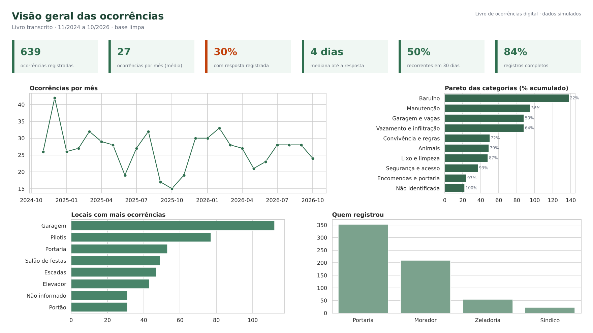
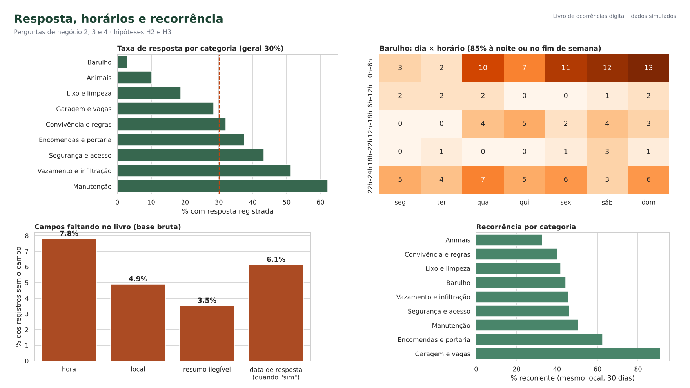
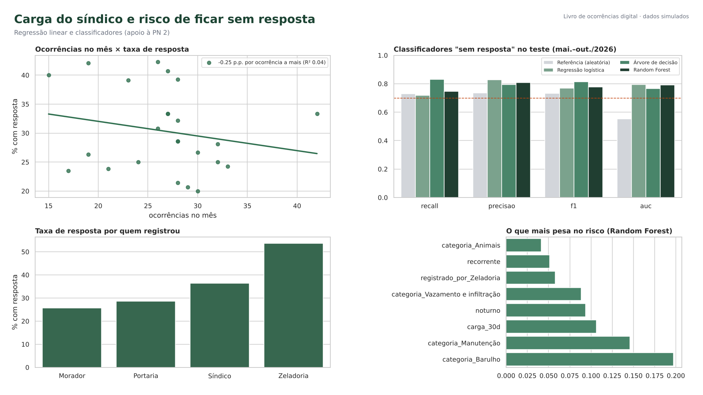

# Livro de Ocorrências Digital – Análise de Dados com CRISP-DM

[](https://colab.research.google.com/github/ram0ng1/Ciencia_de_Dados_Aprendizagem_Maquina/blob/main/Projeto_Ciencia_de_Dados/notebooks/crispdm_livro_ocorrencias.ipynb)

Parte prática do trabalho de **Ciência de Dados e Aprendizagem de Máquina (A1)**, com a Profa. Dra. Kadidja Valéria Reginaldo de Oliveira, no Centro Universitário do Distrito Federal (UDF). O projeto aplica as seis fases do **CRISP-DM** ao **livro de ocorrências de um condomínio residencial do DF**, tema definido na Unidade III ([Definição do Projeto](../Unidade_3_Gestao_de_Projetos_em_Ciencia_de_Dados/Definicao-Projeto-Ciencia-de-Dados.md)). O objetivo é transformar o livro em papel em indicadores para o síndico e preparar a base do livro de ocorrências digital.

Esta parte reúne:
- uma análise em **SQL**, com validações de qualidade da transcrição e os indicadores do painel;
- um **notebook em Python**, com Pareto, mapa de calor, recorrência, diagrama de dispersão com regressão linear e modelagem (classificadores);
- um **dashboard** de três páginas feito em Python (Pandas, Matplotlib e Seaborn) no lugar do Power BI.

Meu papel no projeto é a parte de dados e análise. O sistema e o painel são do Arthur Rodrigues de Souza Vieira (Definição, Seção 14).

> **Dados simulados – coleta ainda pendente.** A transcrição do livro físico, o questionário com os moradores e as entrevistas ainda não foram feitos: dependem da autorização do síndico e da consulta ao CEP (Definição, Seção 8.1). Para desenvolver e testar o método antes da coleta, o notebook **gera** uma base com as colunas do dicionário de dados planejado. Ela traz os problemas esperados de um livro escrito à mão: registros sem hora ou local, ilegíveis, duplicados, categoria escrita de várias formas e número de apartamento vazado. Os números demonstram o método e **não descrevem nenhum condomínio real**. Quando a transcrição chegar, basta trocar a Seção 2.1 do notebook pela leitura do CSV e rodar tudo de novo. O questionário (PN 5 / H4) e o piloto (PN 6 / H5) **não foram simulados**.

## Perguntas de análise

| Pergunta | Técnica | Resposta (dados simulados) |
|---|---|---|
| **P1.** Quais ocorrências mais se repetem, onde, quando, e quais voltam no mesmo local em até 30 dias? (PN 1, 3 e 4) | Pareto, mapa de calor e taxa de recorrência | Barulho, Manutenção e Garagem somam 50,2%. 85% do barulho ocorre à noite ou no fim de semana. Na garagem, 91% das ocorrências se repetem em até 30 dias |
| **P2.** Quantas ocorrências recebem resposta, em quanto tempo, e quais tendem a ficar **sem resposta**? (PN 2) | Indicadores, regressão linear, regressão logística, árvore de decisão e Random Forest | Só 30% têm resposta registrada (mediana de 4 dias). O risco de ficar sem resposta é previsível (AUC 0,79), e quase toda a informação está na categoria |

## Dados

Base bruta em `dados/livro_ocorrencias_transcrito.csv`: 655 registros de nov./2024 a out./2026 (24 meses), com as colunas do dicionário de dados planejado.

| Coluna | Conteúdo |
|---|---|
| `id_registro` | Número sequencial do registro na transcrição |
| `data`, `hora` | Data e hora escritas no livro (a hora pode faltar) |
| `registrado_por` | Portaria, Morador, Zeladoria ou Síndico |
| `local` | Garagem, Pilotis, Portaria, Elevador, Escadas, Salão de festas, Lixeira, Unidade (só o andar)… |
| `categoria_livro` | A categoria **como estava escrita** ("barulho", "som alto", "festa"…) |
| `resumo` | Resumo em linguagem neutra, sem nomes nem número de apartamento |
| `houve_resposta`, `data_resposta`, `desfecho` | Se houve resposta anotada, quando e qual |
| `categoria_ramon`, `categoria_arthur` | Categoria padronizada atribuída por cada autor (categorização em dupla) |
| `categoria_consenso` | Categoria final, decidida em consenso onde a dupla divergiu |

Tabelas geradas pelo notebook em `dados/processed/`:
- `ocorrencias_limpas`: base limpa, 639 linhas;
- `pareto_categorias`;
- `indicadores_mensais`;
- `metricas_modelos`;
- `prototipo_selos_out2026`: selos de "atenção" e "recorrente" do protótipo;
- `resumo_resultados.json`: todos os números citados aqui.

**Termos usados:**
- **Ocorrência:** um registro do livro. É a unidade de análise.
- **Taxa de resposta:** ocorrências com resposta registrada ÷ total.
- **Recorrente:** houve a mesma categoria no mesmo local nos 30 dias anteriores (PN 4).
- **Completo:** data, hora, local e categoria legíveis.

## Principais resultados

| Resultado | Valor | Fonte |
|---|---|---|
| Registros sem hora / sem local / ilegíveis | 51 / 32 / 23 | SQL V1–V3 |
| Datas fora do período (ano trocado na transcrição) | 4 (corrigidos) | SQL V4 |
| Resposta anterior ao registro ou "sim" sem data | 21 | SQL V5 |
| Resumos com número de apartamento (falha de anonimização) | 4 (removidos) | SQL V6 |
| Mesma ocorrência anotada duas vezes | 16 (removidas) | SQL V7 |
| Concordância da categorização em dupla | 86,1% (kappa 0,84; meta ≥ 80%) | SQL C |
| 3 categorias mais frequentes (H1) | 50,2% → confirmada, por pouco | SQL KPI 2 |
| Taxa de resposta registrada (H2) | 30,0% → confirmada | SQL KPI 1 |
| Mediana de dias até a resposta | 4 dias (90% em até 11) | SQL KPI 1 |
| Taxa de resposta: Barulho × Manutenção | 3% × 62% | SQL KPI 4 |
| Taxa de resposta: registro de morador × zeladoria | 26% × 54% | SQL KPI 7 |
| Barulho entre 22h e 6h ou no fim de semana (H3) | 85,0% → confirmada | SQL consulta A |
| Ocorrências recorrentes (mesmo local, 30 dias) | 50,1% (garagem: 91%) | SQL KPI 6 |
| Registros completos | 84,2% | SQL KPI 1 |
| Regressão linear ocorrências no mês × taxa de resposta | −0,25 p.p. por ocorrência · R² = 0,04 (sem relação) | Notebook, seção 3.5 |
| Melhor classificador "sem resposta" (regressão logística) | Recall 0,72 · Precisão 0,83 · F1 0,77 · AUC 0,79 | Notebook, Fase 4 |
| Regra simples (só a categoria) × modelo completo | AUC 0,78 × 0,79 · F1 0,78 × 0,77 | Notebook, Fase 5 |

**Observações:**
- **O barulho é o problema mais frequente e o menos respondido.** São 21,6% das ocorrências, mas só 3% têm resposta registrada. Na prática, o livro serve de desabafo e não de canal. Esse é o achado que mais justifica o registro digital com status e retorno ao morador.
- **O volume do mês não explica a falta de resposta.** A regressão linear entre ocorrências no mês e taxa de resposta é praticamente plana (R² = 0,04). O que pesa é o tipo de ocorrência e quem registrou.
- **Uma regra simples basta para o sistema.** O classificador atinge os três critérios (recall ≥ 0,70, AUC ≥ 0,70 e F1 acima da referência). Usar só a categoria dá o mesmo resultado. Assim, o painel pode mostrar a taxa de resposta histórica de cada categoria e destacar as que costumam ficar sem retorno, sem ML, coerente com o escopo da Definição (Seção 9).
- **A garagem é um conflito crônico.** 91% das ocorrências de garagem repetem outra dos 30 dias anteriores. Isso pede regra e sinalização das vagas, não resposta caso a caso.
- **A qualidade do livro também é um achado.** 16% dos registros estão incompletos e 4 resumos vazaram o número do apartamento. As duas coisas reforçam a necessidade de campos obrigatórios e de anonimização no sistema.
- **H1 confirmada por 0,2 ponto.** É um bom exemplo de por que o critério de refutação foi escrito antes da análise. Com dados reais, o resultado pode virar.

## SQL

`livro_ocorrencias.sql` (PostgreSQL) contém:
- **Tabela:** criação de `ocorrencia_bruta` e o comando `\copy` para carregar o CSV.
- **V1–V7:** validações de qualidade da transcrição: sem hora, sem local, ilegível, data fora do período, resposta inconsistente, identificador no resumo e duplicados.
- **C:** concordância da categorização em dupla.
- **`ocorrencias_limpas`:** view com a base limpa (Fase 3), com recorrência, carga dos últimos 30 dias e completude.
- **KPI 1–KPI 7:** os indicadores do painel do síndico:
  - visão geral;
  - Pareto;
  - locais;
  - resposta por categoria;
  - mapa de calor do barulho;
  - recorrência;
  - resposta por quem registrou.
- **Consultas A e B:** hipótese H3 e série mensal da dispersão.

Para conferir sem instalar o PostgreSQL: `python scripts/rodar_sql_duckdb.py` executa o arquivo inteiro no DuckDB. No fim, o script **confere se os indicadores do SQL são iguais aos do notebook**. Esse é o critério "indicadores reproduzíveis" da Definição, já que o painel do sistema usa estas consultas.

`Livro_Ocorrencias_Analise_SQL.pdf` (19 páginas) traz uma capa e uma consulta por página, com o SQL colorido e o resultado logo abaixo. É gerado por `python scripts/gerar_pdf_consultas.py`.

## Notebook

`notebooks/crispdm_livro_ocorrencias.ipynb` percorre as seis fases do CRISP-DM:

| Fase | O que o notebook faz |
|---|---|
| 1. Entendimento do negócio | Resume objetivos, metas técnicas e critérios de sucesso a partir da Definição do Projeto |
| 2. Entendimento dos dados | Gera a base com o dicionário de dados planejado, descreve volume e tipos e verifica a qualidade (V1–V7) e a concordância da dupla |
| 3. Preparação dos dados | Remove identificadores e duplicados, corrige datas e constrói atributos (noturno, fim de semana, carga, recorrência, completude). Responde às PN 1–4, testa H1–H3 e traça o diagrama de dispersão com regressão linear |
| 4. Modelagem | Regressão logística, árvore de decisão e Random Forest para "sem resposta", com teste temporal (treino nov./2024–abr./2026, teste mai.–out./2026) |
| 5. Avaliação | Confronta com os critérios, revisa os erros por categoria e itera comparando com uma regra só por categoria |
| 6. Implementação | Indicadores do painel (SQL), selos "atenção" e "recorrente", prazo de resposta proposto e monitoramento |

O notebook é autossuficiente: gera a própria base e roda direto no Colab pelo botão no topo desta página (**Ambiente de execução → Executar tudo**).

## Dashboard

O dashboard foi feito em Python no lugar do Power BI, com as bibliotecas de visualização da disciplina:
- **Pandas** agrega os dados;
- **Seaborn** desenha os gráficos (`barplot`, `lineplot`, `heatmap` e `regplot`);
- **Matplotlib** monta as páginas.

Ele é gerado pelo próprio notebook e salvo em `Dashboard/`. São as mesmas visões que o painel do síndico vai mostrar no sistema.

**Página 1 – Visão geral:** indicadores do período, ocorrências por mês, Pareto das categorias, locais e quem registrou.



**Página 2 – Resposta, horários e recorrência:** taxa de resposta por categoria, mapa de calor do barulho, campos faltando no livro e recorrência por categoria.



**Página 3 – Dispersão e modelos:** ocorrências no mês × taxa de resposta com reta de regressão, métricas dos classificadores, resposta por quem registrou e atributos mais importantes.



Para gerar as imagens de novo, basta executar o notebook.

## Etapas pendentes

| Etapa | Situação | O que muda aqui quando for feita |
|---|---|---|
| Transcrição anonimizada do livro (12 a 24 meses) | Pendente: depende da autorização do síndico e da consulta ao CEP | Trocar a Seção 2.1 do notebook pela leitura do CSV real e reexecutar notebook, SQL e PDF |
| Formulário com os moradores (PN 5 / H4) | Pendente: o formulário ainda vai ser aplicado | Acrescentar a análise por faixa etária e as barreiras |
| Entrevistas com síndico e portaria | Pendente | Validar as categorias e o prazo de resposta proposto |
| Piloto do sistema (PN 6 / H5) | Pendente: depende do sistema publicado | Recalcular os mesmos KPIs com os registros do sistema e comparar antes × depois |

## Como executar localmente

```bash
pip install -r requirements.txt
cd notebooks && jupyter nbconvert --to notebook --execute --inplace crispdm_livro_ocorrencias.ipynb && cd ..   # gera dados/ e Dashboard/
python scripts/rodar_sql_duckdb.py                                                                           # validações, KPIs e conferência com o notebook
python scripts/gerar_pdf_consultas.py                                                                        # PDF das consultas
```

## Estrutura

```
├── Dashboard/                       páginas do dashboard (PNG), geradas pelo notebook com Seaborn
├── dados/                           transcrição simulada do livro (CSV)
│   └── processed/                   tabelas geradas pelo notebook
├── notebooks/                       notebook CRISP-DM (abre no Colab)
├── scripts/                         SQL no DuckDB e PDF das consultas
├── livro_ocorrencias.sql            validações, view da base limpa, KPIs e consultas de apoio
├── Livro_Ocorrencias_Analise_SQL.pdf  consultas com os resultados
├── requirements.txt
└── README.md
```

## Ferramentas

- PostgreSQL / DuckDB (SQL)
- Pandas e NumPy (preparação dos dados)
- Matplotlib e Seaborn (visualização e dashboard, no lugar do Power BI)
- scikit-learn (regressão linear e classificadores)
- Playwright (PDF das consultas)
- Jupyter / Google Colab

## Autor

- Ramon Guilherme Marques do Nascimento – dados e análise (P1 e P2)

Projeto em dupla com Arthur Rodrigues de Souza Vieira (desenvolvimento do sistema e do painel).

## Sobre

Projeto-base: *Livro de ocorrências digital para condomínios residenciais: do registro em papel a indicadores para a gestão do síndico* (UDF, 2026). Metodologia: CRISP-DM (Chapman et al., 2000), seguindo o guia da disciplina.

`crisp-dm` `data-science` `sql` `postgresql` `python` `scikit-learn` `pareto` `condominio` `lgpd`
